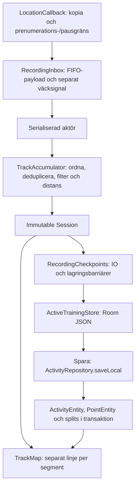

# GPS_CODE_REVIEW – Min Tracker 1.0.7

Datum: 2026-10-11. Arbetsrot: `C:/Users/oxelv/Downloads/löpning`. Baslinje: publicerad 1.0.6, Git `1c8be093258230ad964d2d2bbfb66645273afb16`. Kandidat: **1.0.7 / versionCode 8**. Publiceringsstatus redovisas i leveransbeskedet; tidigare APK/release 1.0.6 ersätts inte.

Telefonmodell uppgavs som ”s32”; exakt Samsungmodell, Android-/One UI-version och installerad testversion är obekräftade. Bilhastighet är giltig. Tester använder syntetiska GPS-koordinater och disponibla testkonton.

## Resultat och åtgärder

De tre tidigare verifierade korrigeringarna behålls: giltiga bilpunkter kastas inte vid 43,2 km/h; små rörelser sparas separat från tvåmetersfiltret för distans; giltig historik från den aktuella GPS-prenumerationen kastas inte på grund av leveransålder. Tidigare gav 20 bil-/långsamhetspunkter endast 2 sparade punkter och en fördröjd batch gav 0 av 2. Regressionstesterna går igenom med korrigeringarna.

| Senaste uppdraget | Implementering och verifiering |
|---|---|
| 1. Misslyckad `trySend` | `RecordingInbox` äger payload i en FIFO. Kanalen innehåller endast väcksignaler. Full/stängd signalkanal tar inte bort GPS-payload; tjänsten startar en reservdränering under samma mutex. Testet erbjuder 100 payloads både med full och stängd kanal och hämtar alla exakt en gång. |
| 2. Batcher ur ordning | `TrackAccumulator.addBatch` deduplicerar på mättid och behåller råfix för aktuell registreringsdel. Vid en sen punkt spelas denna del om i tidsordning från ett sparat beräkningsankare. Distans, segment, höjd, hastighet och splits återställs före omräkning. Tidigare delar före paus/återställning ändras inte. Ett test som tidigare tappade en kurvpunkt ger nu samma distans och hastighet som ordnad leverans. En sent inkommen punkt kan också reparera en falsk 30-sekunderslucka. |
| 3. Paus/stopp | Mättidsgränsen fryses vid kommandot. `flushLocations()` och därefter `removeLocationUpdates()` väntas in utanför skrivaktören. En huvudtrådsbarriär lägger avslut efter redan levererade callbacks. Endast fix mätta före gränsen accepteras. Därefter sparas PAUSED/STOPPING med en lagringsbarriär. Timeout/fel ger en synlig varning; mottagna data sparas. Riktigt tjänsttest kontrollerar sista fix vid omedelbar paus/stopp, utesluter rörelse under pausen och kontrollerar segment/dubbletter. |
| 4. 1 s jämfört med 3 s | Modellerat på samma syntetiska 30-minutersrutt: 1 s gav 1 801 punkter, cirka 84 ms tråd-CPU och 5 403,77 m; 3 s gav 601 punkter, cirka 40 ms och 5 397,28 m. Tätare sampling behöll cirka 6,49 m mer av kurvan i detta exempel. Ingen fysisk energimätning är gjord. **3 s behålls som standard**, eftersom ett allmänt byte till 1 s inte har visats vara värt den högre kostnaden. |
| 5. Room-checkpoints | `RecordingCheckpoints` skriver separat på IO. Mellanliggande snapshots sammanfogas; GPS-händelser sammanfogas inte. En mutex ordnar riktiga lagringsbarriärer så att en äldre ACTIVE-snapshot inte kan skriva över STOPPING. Testet blockerar skrivaren och schemalägger 1 000 nya snapshots utan att vänta på lagringen; den slutliga STOPPING-snapshoten ligger sist. |
| 6. Regressioner | Befintliga bil-, långsamhets-, jitter-, batch-, Room- och låsskärmstester finns kvar. Nya tester täcker ordning, duplicering, segmentreparation, pausgräns, kilometertider, köfel, långsam skrivare, flushordning/timeout och ett komplett paus-/stoppförlopp. |

### Kilometertider

Ett separat reproducerat fel var att flera kilometermarkeringar i en batch använde leveransens `activeMs`: första kilometern fick leveranstiden och nästa kunde få 0 ms. Den slutliga koden mappar positionens monotona mättid mot aktiv tid vid GPS-prenumerationens start och interpolerar kilometertid mellan distansankarna. Det gör även omspelning av sena punkter oberoende av leveranstiden. Fallback för positioner utan monotontid använder väggtid.

### Kö- och livscykelkontrakt

Det är payload-kön, inte väckkanalen, som äger en accepterad GPS-händelse. Efter **uttrycklig stängning av inboxen** returnerar `offer` false; den låtsas inte att en ny händelse accepterats. Normal paus/stopp tömmer provider och kö innan gränsen avslutas. Vid tjänstens `onDestroy` dräneras redan mottagna händelser och sista checkpointen försöks skrivas i en separat, tidsbegränsad avslutare (10 s), även när tjänstens vanliga scope avbryts. Ett Android Force stop/processdöd kan fortfarande avbryta exekvering utan någon sådan garanti. Inga uppmätta GPS-punkter kan skapas retroaktivt.

GPS-ackumulatorn och kommandon är serialiserade med samma aktörsmutex. Försenade flush-callbacks måste få komma in medan flush väntas in; därför väntar inte själva aktören på leverantören. Snabba efterföljande kontrollkommandon köas till efter pågående övergång. Återupptagning öppnar en ny registreringsdel och ny GPS-prenumerationsgräns.

## Hundbilder: verifierad backendorsak

Uppladdning via både riktig Android `AvatarRepository.saveDog` och Storage-REST gav HTTP 400 / AccessDenied / row-level security. Granskning av de fyra befintliga hundbildsreglerna visade att underfrågan band `storage.foldername(name)` till **`dogs.name`**, inte till objektets sökväg. Reglerna korrigeras genom uttrycklig `storage.foldername(objects.name)`. JPEG-filnamnets punkt uttrycks med `[.]` för att undvika felaktig backslash-escaping.

SQL finns i `C:/Users/oxelv/Downloads/löpning/supabase/proposals/202610110012_dog_avatar_storage_fix.sql`. Den ändrar fyra befintliga policies för privata hundbilder, behåller ägarkontroll och rör inte tabeller, buckets, publika läsrättigheter eller den separata kontospärren. Lokala Postgres/RLS-tester täcker reproduktion, egen upload/read/update/delete, konto-isolering, felaktiga sökvägar och fel bucket.

**Backendstatus:** användaren godkände de fyra policyändringarna den 11 oktober 2026 och SQL-korrigeringen har installerats i Supabase. Det separata Android-testet `LiveDogAvatarDeviceTest.chosenImageIsSavedAndDisplayedForOwnedDog` passerar nu mot den riktiga backendmiljön: PNG, JPEG-konvertering, uppladdning, Room-referens, signerad bildhämtning/avkodning och borttagning. Samma test misslyckades före korrigeringen. Logg: `C:/Users/oxelv/Downloads/löpning/tmp/dog-avatar-android-green.log`.

## LocationRequest och Android

`PRIORITY_HIGH_ACCURACY`, önskat intervall 3 000 ms, minsta intervall 1 500 ms, minsta distans 0 m, max update delay 6 000 ms och initial cacheålder 0 ms. Samma intervall, prioritet och batchfönster som före uppdateringen; ingen permanent wakelock. Noggrannhetsgräns 40 m, distansankare 2 m, plausibilitetsskydd mot extrema hopp 100 m/s (360 km/h). Detta skydd är ett uttryckligt domänval och stöder inte alla flyg-/tåghastigheter.

Foreground-promotion sker synkront före Room-I/O. Nedräkningen ägs av tjänsten och använder ett tidsbegränsat partiellt wakelock; det släpps efter aktivering/stopp. GPS-prenumerationen börjar när nedräkningen slutar. UI-förberedelsen har separata engångspositioner, som inte registreras som träningspunkter.

Manifestet innehåller FINE/COARSE_LOCATION, FOREGROUND_SERVICE, FOREGROUND_SERVICE_LOCATION, WAKE_LOCK, POST_NOTIFICATIONS och ACTIVITY_RECOGNITION. Tjänsten är privat och deklarerar foreground-typen location. Precis platsbehörighet kontrolleras. Start sker från synlig Activity; ingen bakgrundsplatsbehörighet införs.

Google dokumenterar att batching kan ge batcher ur ordning och att `flushLocations()` tömmer providerbufferten. Intervall är önskemål, inte garanterad leveranstakt. [FusedLocationProviderClient](https://developers.google.com/android/reference/com/google/android/gms/location/FusedLocationProviderClient), [LocationRequest.Builder](https://developers.google.com/android/reference/com/google/android/gms/location/LocationRequest.Builder).

Android beskriver sambandet mellan täta platsuppdateringar och energikostnad; emitterat punktantal/CPU i emulatorn är inte en batterimätning på Samsung. [Optimera platsanvändning](https://developer.android.com/develop/sensors-and-location/location/battery/optimize). Monoton mättid kommer från [Android Location](https://developer.android.com/reference/android/location/Location).

## Mottagning, filtrering, lagring och ritning



- Kontinuerlig inmatning som tidigare gav få lagrade punkter var ett filterfel, inte ett kartfel.
- En gammal leverans med giltiga mättider är fördröjd historik, inte automatiskt utebliven GPS.
- Kartan bryter vid explicit segmentbyte eller lucka >30 s. Enstaka punkter i ett segment ger ingen linje.
- Historikkartans förenkling ändrar bara visningsgeometrin; Room behåller originalpunkter. Offline kartbakgrund stoppar inte GPS.
- `GPS_SIGNAL_LOST` använder senaste accepterade punkt. Den koden ensam bevisar inte att leverantören helt slutat skicka callbacks.

## Kvarstående avgränsningar

1. Fysisk Samsung, verklig GPS/Doze och batteriförbrukning är inte verifierade här. Emulatorns låsskärmstester kan inte bevisa tillverkarens beteende. Exakt modell/Android/One UI behövs för fortsatt telefonfelsökning.
2. Molnkontraktets `CloudPoint` saknar fortfarande `segment` och `accuracy`; återställning på annan telefon använder standardvärden. Korta pausgränser kan därför ritas ihop efter molnåterställning. Det kräver en separat godkänd kontrakts-/schemaändring och ändras inte som en dold del av hundbildspolicyn. Lokalt Room bevarar segment.
3. Punktmodellen, nedräkningsdeadline och vissa UI-/diagnostikåldrar använder väggtid. Mottagning och splittid använder monotontid när den finns, men en manuell systemklockändring mitt i passet behöver eget test och vidare tidsmodellering.
4. Vid en sen batch spelas aktuell registreringsdel om. Det kräver extra minne för råfix och O(n) arbete för denna del; normal tidsordnad leverans använder snabb append och en publicering per batch. Extremt långa pass och många sena batcher behöver fysisk profilering. Kartans per-segment-förenkling/export har också kvar visst huvudtrådsarbete.
5. Room skriver fortsatt hela sessions-JSON. IO är nu skilt från GPS-aktören, men ändlig disk, skrivfel eller processdöd kan begränsa vad som hinner bli varaktigt. Senast lyckade checkpoint bevaras; inga destruktiva databasändringar införs.

## Testresultat

Slutligt releasebygge: BUILD SUCCESSFUL (2 min 55 s). **86 JVM-tester godkända; 61 Android-testfall: 55 godkända, 6 överhoppade, 0 fel.** Lint: 0 fel, 58 varningar. Slutlig bygglogg: C:/Users/oxelv/Downloads/löpning/tmp/gps-final-release-validation.log. Separat processprov godkänt: paketersättning med bevarad inloggning, SIGKILL, Force stop, återställning och exakt en lokal sparning. Logg: tmp/gps-final-process-recovery.log. Sex lokala RLS-regressionsgrupper för hundbilder godkända. Det separata skarpa Android-hundbildstestet passerar efter den godkända serverkorrigeringen (1 test, 0 fel).

Kommandon:
```powershell
./gradlew.bat :app:testDebugUnitTest :app:assembleRelease :app:assembleDebug :app:connectedDebugAndroidTest :app:lintDebug '-Pkotlin.incremental=false'
node tools/backend-tests/dog-avatar-policy.mjs
./tools/backend-tests/Test-LiveDogAvatar.ps1
```

Signeringsmiljön anges separat och skrivs inte ut i rapporten. SHA-256 för APK och certifikat kontrolleras före uppladdning. Ingen autentiseringsuppgift, signerad privat bild-URL eller riktig användarrutt ingår i rapporten.

Testfiler ligger under `C:/Users/oxelv/Downloads/löpning/app/src/androidTest/java/se/private/mintracker/data/`: `GpsFlowRegressionTest`, `RecordingPipelineTest`, `TrainingDurabilityDeviceTest`, `ActiveTrainingDatabaseTest`, `LiveDogAvatarDeviceTest`. RLS-test: `tools/backend-tests/dog-avatar-policy.mjs`.

## Exakta filer, klasser och metoder

Katalogen är `se/private/mintracker`, medan Kotlin-paketet är `se.oxelv.mintracker`. Radnumren nedan är genererade ur slutlig arbetskopia; `N |` är rapportannotering.

| Absolut sökväg | Klass | Metoder |
|---|---|---|
| `C:/Users/oxelv/Downloads/löpning/app/src/main/java/se/private/mintracker/tracking/GpsLocationBatch.kt` | `GpsLocationBatch` | `receivedLocations(), request()` |
| `C:/Users/oxelv/Downloads/löpning/app/src/main/java/se/private/mintracker/tracking/TrackingService.kt` | `TrackingService` | `callback.onLocationResult(), requestUpdates(), control(), finishControl(), onStartCommand(), onDestroy()` |
| `C:/Users/oxelv/Downloads/löpning/app/src/main/java/se/private/mintracker/tracking/RecordingInbox.kt` | `RecordingInbox` | `offer(), poll(), awaitSignal(), close()` |
| `C:/Users/oxelv/Downloads/löpning/app/src/main/java/se/private/mintracker/tracking/RecordingCheckpoints.kt` | `RecordingCheckpoints` | `schedule(), flush(), close()` |
| `C:/Users/oxelv/Downloads/löpning/app/src/main/java/se/private/mintracker/tracking/GpsDrain.kt` | `GpsDrain` | `finish()` |
| `C:/Users/oxelv/Downloads/löpning/app/src/main/java/se/private/mintracker/tracking/TrackingState.kt` | `TrackAccumulator` | `addBatch(), addOrdered(), beginLocationRequest(), publish(), pause(), resume()` |
| `C:/Users/oxelv/Downloads/löpning/app/src/main/java/se/private/mintracker/data/ActiveTraining.kt` | `ActiveTrainingStore` | `checkpoint(), load()` |
| `C:/Users/oxelv/Downloads/löpning/app/src/main/java/se/private/mintracker/data/ActivityRepository.kt` | `ActivityRepository` | `saveLocal(), upload(), importActivity()` |
| `C:/Users/oxelv/Downloads/löpning/app/src/main/java/se/private/mintracker/data/LocalData.kt` | `PointEntity / ActivityDao` | `points(), insertPoints()` |
| `C:/Users/oxelv/Downloads/löpning/app/src/main/java/se/private/mintracker/MainActivity.kt` | `MainActivity / toppnivå` | `service(), TrackMap(), fitRoute()` |
| `C:/Users/oxelv/Downloads/löpning/app/src/main/java/se/private/mintracker/tracking/RouteSegments.kt` | `toppnivå` | `routeSegments()` |
| `C:/Users/oxelv/Downloads/löpning/app/src/main/java/se/private/mintracker/data/RouteDisplay.kt` | `RouteDisplayBuilder` | `build(), simplify()` |
| `C:/Users/oxelv/Downloads/löpning/app/src/main/java/se/private/mintracker/MapExportRenderer.kt` | `MapExportRenderer` | `capture()` |
| `C:/Users/oxelv/Downloads/löpning/app/src/main/java/se/private/mintracker/data/AvatarRepository.kt` | `AvatarRepository / AvatarImageProcessor` | `saveDog(), signedUrl(), removeDog(), jpeg()` |

### GpsLocationBatch.kt

Fil: `C:/Users/oxelv/Downloads/löpning/app/src/main/java/se/private/mintracker/tracking/GpsLocationBatch.kt`

Rader 1–28.

```kotlin
   1 | package se.oxelv.mintracker.tracking
   2 |
   3 | import android.location.Location
   4 | import android.os.SystemClock
   5 | import com.google.android.gms.location.LocationRequest
   6 | import com.google.android.gms.location.Priority
   7 |
   8 | /** The service's reception boundary, separate from the serialized Room writer. */
   9 | internal object GpsLocationBatch {
  10 |     fun receivedLocations(locations: List<Location>, receivedWallMs: Long,
  11 |         requestStartedElapsedNanos: Long, requestStartedWallMs: Long,
  12 |         receivedElapsedNanos: Long = SystemClock.elapsedRealtimeNanos(),
  13 |         cutoffElapsedNanos: Long = Long.MAX_VALUE, cutoffWallMs: Long = Long.MAX_VALUE): List<Location> =
  14 |         locations.filter {
  15 |             // Delivery age is not measurement age: delayed fixes from this request are history.
  16 |             if (it.elapsedRealtimeNanos > 0) {
  17 |                 it.elapsedRealtimeNanos >= requestStartedElapsedNanos && it.elapsedRealtimeNanos <= receivedElapsedNanos &&
  18 |                     it.elapsedRealtimeNanos <= cutoffElapsedNanos
  19 |             } else it.time >= requestStartedWallMs && it.time <= receivedWallMs + 5_000 && it.time <= cutoffWallMs
  20 |         }.sortedBy { it.time }.map { Location(it) }
  21 |
  22 |     fun request(): LocationRequest = LocationRequest.Builder(Priority.PRIORITY_HIGH_ACCURACY, 3000)
  23 |         .setMinUpdateIntervalMillis(1500)
  24 |         .setMinUpdateDistanceMeters(0f)
  25 |         .setMaxUpdateDelayMillis(6000)
  26 |         .setMaxUpdateAgeMillis(0)
  27 |         .build()
  28 | }
```

### RecordingInbox.kt

Fil: `C:/Users/oxelv/Downloads/löpning/app/src/main/java/se/private/mintracker/tracking/RecordingInbox.kt`

Rader 1–21.

```kotlin
   1 | package se.oxelv.mintracker.tracking
   2 |
   3 | import kotlinx.coroutines.channels.Channel
   4 |
   5 | /** The channel only wakes the consumer; payloads remain owned until explicitly polled. */
   6 | internal class RecordingInbox<T>(private val signal: Channel<Unit> = Channel(Channel.CONFLATED),
   7 |     private val onSignalFailure: () -> Unit = {}) {
   8 |     private val pending = ArrayDeque<T>()
   9 |     private var accepting = true
  10 |     fun offer(value: T): Boolean {
  11 |         synchronized(pending) {
  12 |             if (!accepting) return false
  13 |             pending.addLast(value)
  14 |         }
  15 |         if (signal.trySend(Unit).isFailure) onSignalFailure()
  16 |         return true
  17 |     }
  18 |     fun poll(): T? = synchronized(pending) { if (pending.isEmpty()) null else pending.removeFirst() }
  19 |     suspend fun awaitSignal(): Boolean = signal.receiveCatching().isSuccess
  20 |     fun close() { synchronized(pending) { accepting = false }; signal.close() }
  21 | }
```

### RecordingCheckpoints.kt

Fil: `C:/Users/oxelv/Downloads/löpning/app/src/main/java/se/private/mintracker/tracking/RecordingCheckpoints.kt`

Rader 1–33.

```kotlin
   1 | package se.oxelv.mintracker.tracking
   2 |
   3 | import java.util.concurrent.atomic.AtomicReference
   4 | import kotlinx.coroutines.*
   5 | import kotlinx.coroutines.channels.Channel
   6 | import kotlinx.coroutines.sync.Mutex
   7 | import kotlinx.coroutines.sync.withLock
   8 |
   9 | /** Conflate only redundant snapshots, never GPS events or durable pause/stop barriers. */
  10 | internal class RecordingCheckpoints(private val write: suspend (Session) -> Unit,
  11 |     private val onFailure: (Throwable) -> Unit) {
  12 |     private val scope = CoroutineScope(SupervisorJob() + Dispatchers.IO)
  13 |     private val pending = AtomicReference<Session?>()
  14 |     private val wake = Channel<Unit>(Channel.CONFLATED)
  15 |     private val mutex = Mutex()
  16 |     private val worker = scope.launch {
  17 |         for (ignored in wake) {
  18 |             try { mutex.withLock { pending.getAndSet(null)?.let { write(it) } } }
  19 |             catch (error: CancellationException) { throw error }
  20 |             catch (error: Exception) { onFailure(error) }
  21 |         }
  22 |     }
  23 |     fun schedule(session: Session) {
  24 |         pending.set(session)
  25 |         check(wake.trySend(Unit).isSuccess) { "Checkpoint writer closed" }
  26 |     }
  27 |     suspend fun flush(session: Session) = mutex.withLock {
  28 |         pending.set(null)
  29 |         write(session)
  30 |     }
  31 |     suspend fun close() { wake.close(); worker.join(); scope.cancel() }
  32 |     fun cancel() { wake.close(); scope.cancel() }
  33 | }
```

### GpsDrain.kt

Fil: `C:/Users/oxelv/Downloads/löpning/app/src/main/java/se/private/mintracker/tracking/GpsDrain.kt`

Rader 1–19.

```kotlin
   1 | package se.oxelv.mintracker.tracking
   2 |
   3 | import kotlinx.coroutines.*
   4 |
   5 | /** Never hold the recording actor while waiting for provider callbacks. */
   6 | internal object GpsDrain {
   7 |     suspend fun finish(flush: suspend () -> Unit, remove: suspend () -> Unit,
   8 |         callbackBarrier: suspend () -> Unit, timeoutMs: Long = 4000): Throwable? {
   9 |         var failure: Throwable? = null
  10 |         for (operation in listOf(flush, remove)) {
  11 |             try { withTimeout(timeoutMs) { operation() } }
  12 |             catch (error: TimeoutCancellationException) { failure = failure ?: error }
  13 |             catch (error: CancellationException) { throw error }
  14 |             catch (error: Exception) { failure = failure ?: error }
  15 |         }
  16 |         callbackBarrier()
  17 |         return failure
  18 |     }
  19 | }
```

### TrackingService: kö, callback, foreground, nedräkning, flush och checkpoint

Fil: `C:/Users/oxelv/Downloads/löpning/app/src/main/java/se/private/mintracker/tracking/TrackingService.kt`

Rader 30–295.

```kotlin
  30 |     private val eventMutex = Mutex()
  31 |     private var destroying = false
  32 |     private val events: RecordingInbox<suspend () -> Unit> = RecordingInbox(onSignalFailure = {
  33 |         // A failed wake-up never owns/drops the GPS payload. Drain the retained inbox.
  34 |         if (!destroying) scope.launch { drainEvents() }
  35 |     })
  36 |     private lateinit var checkpoints: RecordingCheckpoints
  37 |     private lateinit var fused: FusedLocationProviderClient
  38 |     private lateinit var sensors: SensorManager
  39 |     private lateinit var store: ActiveTrainingStore
  40 |     private var accumulator: TrackAccumulator? = null
  41 |     private var countdown: Session? = null
  42 |     private var started = false
  43 |     private var lastCheckpoint = 0L
  44 |     private var lastNotification = 0L
  45 |     private var firstFixReported = false
  46 |     private var gpsGapReported = false
  47 |     private var gpsRequestedAt = 0L
  48 |     private var requestStartedElapsedNanos = 0L
  49 |     private var requestStartedWallMs = 0L
  50 |     private var requestGeneration = 0L
  51 |     private var cutoffElapsedNanos = Long.MAX_VALUE
  52 |     private var cutoffWallMs = Long.MAX_VALUE
  53 |     private var transition: String? = null
  54 |     private val deferredControls = ArrayDeque<Intent>()
  55 |     private fun enqueue(event: suspend () -> Unit) {
  56 |         if (!events.offer(event) && !destroying) {
  57 |             reportDiagnostic(DiagnosticCode.GPS_SERVICE_STOPPED)
  58 |             scope.launch { eventMutex.withLock { event() } }
  59 |         }
  60 |     }
  61 |     private suspend fun drainEvents() = eventMutex.withLock {
  62 |         while (true) {
  63 |             val event = events.poll() ?: break
  64 |             try { event() }
  65 |             catch (error: CancellationException) { throw error }
  66 |             catch (error: Exception) {
  67 |                 reportDiagnostic(DiagnosticCode.GPS_SERVICE_STOPPED, error)
  68 |                 TrackingState.session.value = TrackingState.session.value.copy(recordingError =
  69 |                     "Registreringen avbröts. Redan sparade data finns kvar. Öppna passet och försök igen.")
  70 |                 stopSelf()
  71 |             }
  72 |         }
  73 |     }
  74 |     private var countdownWakeLock: PowerManager.WakeLock? = null
  75 |     private fun keepCountdownAwake(until: Long) {
  76 |         releaseCountdownWakeLock()
  77 |         countdownWakeLock = (getSystemService(POWER_SERVICE) as PowerManager)
  78 |             .newWakeLock(PowerManager.PARTIAL_WAKE_LOCK, "MinTracker:countdown").apply {
  79 |                 acquire((until - System.currentTimeMillis()).coerceIn(0, 60_000) + 10_000)
  80 |             }
  81 |     }
  82 |     private fun releaseCountdownWakeLock() { countdownWakeLock?.let { if (it.isHeld) it.release() }; countdownWakeLock = null }
  83 |     private val stepListener = object : SensorEventListener {
  84 |         override fun onSensorChanged(event: SensorEvent) { if (transition == null && !destroying) enqueue { accumulator?.addStep() } }
  85 |         override fun onAccuracyChanged(sensor: Sensor?, accuracy: Int) = Unit
  86 |     }
  87 |     private val callback = object : LocationCallback() {
  88 |         override fun onLocationResult(result: LocationResult) {
  89 |             if (destroying) return
  90 |             val generation = requestGeneration
  91 |             val now = System.currentTimeMillis()
  92 |             val locations = GpsLocationBatch.receivedLocations(result.locations, now,
  93 |                 requestStartedElapsedNanos, requestStartedWallMs,
  94 |                 cutoffElapsedNanos = cutoffElapsedNanos, cutoffWallMs = cutoffWallMs)
  95 |             enqueue {
  96 |                 if (generation != requestGeneration) return@enqueue
  97 |                 accumulator?.tick(if (transition != null) cutoffElapsedNanos / 1_000_000 else SystemClock.elapsedRealtime())
  98 |                 accumulator?.addBatch(locations)
  99 |                 persist()
 100 |                 if (accumulator?.snapshot?.points?.lastOrNull()?.let { now - it.timestamp < 30_000 } == true) gpsGapReported = false
 101 |                 if (!firstFixReported && accumulator?.snapshot?.points?.isNotEmpty() == true) {
 102 |                     firstFixReported = true; reportDiagnostic(DiagnosticCode.GPS_FIRST_FIX)
 103 |                 }
 104 |             }
 105 |         }
 106 |     }
 107 |     override fun onCreate() {
 108 |         super.onCreate()
 109 |         fused = LocationServices.getFusedLocationProviderClient(this)
 110 |         sensors = getSystemService(SENSOR_SERVICE) as SensorManager
 111 |         store = ActiveTrainingStore(TrackerDatabaseProvider.get(this))
 112 |         checkpoints = RecordingCheckpoints(store::checkpoint) { error ->
 113 |             if (!destroying) enqueue { throw error }
 114 |         }
 115 |         (getSystemService(NOTIFICATION_SERVICE) as NotificationManager).createNotificationChannel(
 116 |             NotificationChannel(CHANNEL, "Pågående pass", NotificationManager.IMPORTANCE_LOW))
 117 |         scope.launch {
 118 |             while (events.awaitSignal()) drainEvents()
 119 |         }
 120 |         scope.launch {
 121 |             while (isActive) {
 122 |                 delay(1000)
 123 |                 enqueue {
 124 |                     val pending = countdown
 125 |                     if (pending != null && System.currentTimeMillis() >= pending.countdownUntil) activate(pending)
 126 |                     accumulator?.tick(if (transition != null) cutoffElapsedNanos / 1_000_000 else SystemClock.elapsedRealtime())
 127 |                     val recording = accumulator?.snapshot
 128 |                     if (recording != null && !recording.paused && gpsRequestedAt != 0L &&
 129 |                         SystemClock.elapsedRealtime() - gpsRequestedAt > 60_000 &&
 130 |                         recording.points.lastOrNull()?.let { System.currentTimeMillis() - it.timestamp > 30_000 } != false && !gpsGapReported) {
 131 |                         gpsGapReported = true; reportDiagnostic(DiagnosticCode.GPS_SIGNAL_LOST)
 132 |                     }
 133 |                     if (started && SystemClock.elapsedRealtime() - lastCheckpoint >= 5_000) persist()
 134 |                     if (started && SystemClock.elapsedRealtime() - lastNotification >= 5_000) updateNotification()
 135 |                 }
 136 |             }
 137 |         }
 138 |     }
 139 |     override fun onStartCommand(intent: Intent?, flags: Int, startId: Int): Int {
 140 |         if (intent?.action in setOf(STOP, PAUSE, RESUME)) {
 141 |             enqueue { control(checkNotNull(intent)) }
 142 |             return START_STICKY
 143 |         }
 144 |         if (!hasLocation()) { stopSelf(); return START_NOT_STICKY }
 145 |         // Synchronous promotion precedes Room I/O and the caller locking the screen.
 146 |         try {
 147 |             if (Build.VERSION.SDK_INT >= 29) startForeground(1, notification(), ServiceInfo.FOREGROUND_SERVICE_TYPE_LOCATION)
 148 |             else startForeground(1, notification())
 149 |         } catch (error: RuntimeException) {
 150 |             reportDiagnostic(DiagnosticCode.GPS_START_FAILED, error)
 151 |             TrackingState.session.value = TrackingState.session.value.copy(recordingError =
 152 |                 "Android kunde inte starta GPS-tjänsten. Öppna appen och kontrollera platsbehörigheten. Sparade data finns kvar.")
 153 |             stopSelf(); return START_NOT_STICKY
 154 |         }
 155 |         enqueue {
 156 |             if (destroying) return@enqueue
 157 |             if (started) return@enqueue
 158 |             val owner = intent?.getStringExtra(EXTRA_USER_ID) ?: SecureSessions.store.owner
 159 |             if (owner.isNullOrBlank()) { stopForeground(STOP_FOREGROUND_REMOVE); stopSelf(); return@enqueue }
 160 |             val old = store.load(owner)
 161 |             if (old != null) {
 162 |                 if (old.status == "STOPPING") {
 163 |                     TrackingState.session.value = old; stopForeground(STOP_FOREGROUND_REMOVE); stopSelf(); return@enqueue
 164 |                 }
 165 |                 val restored = old.copy(interruptions = old.interruptions + 1,
 166 |                     recordingError = "Passet har återställts efter ett registreringsavbrott. Saknad tid och sträcka räknas inte.")
 167 |                 reportDiagnostic(DiagnosticCode.SESSION_RESTORED)
 168 |                 started = true
 169 |                 if (restored.status == "COUNTDOWN") {
 170 |                     keepCountdownAwake(restored.countdownUntil)
 171 |                     countdown = restored; TrackingState.session.value = restored
 172 |                     if (System.currentTimeMillis() >= restored.countdownUntil) activate(restored)
 173 |                 } else activate(restored)
 174 |             } else if (intent?.action == START) {
 175 |                 val kind = ActivityKind.fromStored(intent.getStringExtra(EXTRA_KIND) ?: "RUN")
 176 |                 val dog = intent.getStringExtra(EXTRA_DOG_ID)
 177 |                 require(kind != null && kind.requiresDog == (dog != null))
 178 |                 if (dog != null) require(TrackerDatabaseProvider.get(this@TrackingService).dogDao().byId(dog, owner) != null)
 179 |                 val now = System.currentTimeMillis()
 180 |                 val until = now + intent.getIntExtra(EXTRA_COUNTDOWN, 0).coerceIn(0, 60) * 1000L
 181 |                 keepCountdownAwake(until)
 182 |                 val pending = Session(kind = kind.name, ownerUserId = owner, dogId = dog,
 183 |                     startedAt = until, countdownUntil = until, running = true, status = "COUNTDOWN", checkpointAt = now)
 184 |                 store.checkpoint(pending)
 185 |                 reportDiagnostic(DiagnosticCode.COUNTDOWN_STARTED)
 186 |                 reportDiagnostic(DiagnosticCode.SERVICE_STARTED)
 187 |                 countdown = pending; started = true; TrackingState.serviceRunning.value = true; TrackingState.session.value = pending
 188 |                 if (until <= now) activate(pending)
 189 |             } else { stopForeground(STOP_FOREGROUND_REMOVE); stopSelf(); return@enqueue }
 190 |             persist(); updateNotification()
 191 |         }
 192 |         return START_STICKY
 193 |     }
 194 |     private suspend fun control(intent: Intent) {
 195 |         val requestedOwner = intent.getStringExtra(EXTRA_USER_ID)
 196 |         val owned = countdown ?: accumulator?.snapshot
 197 |         if (requestedOwner != null && owned != null && owned.ownerUserId != requestedOwner) return
 198 |         if (transition != null) { deferredControls.addLast(Intent(intent)); return }
 199 |         if (owned == null && intent.action != STOP) { stopSelf(); return }
 200 |         if (intent.action == RESUME) {
 201 |             if (accumulator?.snapshot?.paused == true) {
 202 |                 accumulator?.resume(); requestUpdates()
 203 |                 accumulator?.snapshot?.let { checkpoints.flush(it) }
 204 |                 updateNotification()
 205 |             }
 206 |             return
 207 |         }
 208 |         if (intent.action == PAUSE && (countdown != null || owned?.paused == true)) return
 209 |         transition = intent.action
 210 |         cutoffElapsedNanos = SystemClock.elapsedRealtimeNanos()
 211 |         cutoffWallMs = System.currentTimeMillis()
 212 |         accumulator?.tick(cutoffElapsedNanos / 1_000_000)
 213 |         // Return to the actor now, so callbacks produced by flush can be consumed.
 214 |         scope.launch {
 215 |             val failure = GpsDrain.finish(
 216 |                 flush = { if (accumulator?.snapshot?.paused == false) fused.flushLocations().awaitCompletion() },
 217 |                 remove = { fused.removeLocationUpdates(callback).awaitCompletion() },
 218 |                 callbackBarrier = { suspendCancellableCoroutine<Unit> { continuation ->
 219 |                     Handler(Looper.getMainLooper()).post { if (continuation.isActive) continuation.resume(Unit) }
 220 |                 } })
 221 |             enqueue { finishControl(intent, failure) }
 222 |         }
 223 |     }
 224 |     private suspend fun finishControl(intent: Intent, failure: Throwable?) {
 225 |         requestGeneration++
 226 |         accumulator?.pause(cutoffElapsedNanos / 1_000_000)
 227 |         if (failure != null) accumulator?.setRecordingError("GPS-bufferten kunde inte tömmas helt. Redan mottagna punkter har sparats.")
 228 |         val state = countdown ?: accumulator?.snapshot ?: (intent.getStringExtra(EXTRA_USER_ID) ?: SecureSessions.store.owner)?.let { store.load(it) }
 229 |         if (failure != null) reportDiagnostic(DiagnosticCode.GPS_SERVICE_STOPPED, failure)
 230 |         val checked = state?.let { if (failure == null) it else it.copy(recordingError =
 231 |             "GPS-bufferten kunde inte tömmas helt. Redan mottagna punkter har sparats.") }
 232 |         if (intent.action == STOP) {
 233 |             checked?.let {
 234 |                 val stopped = it.copy(status = "STOPPING", running = false, paused = true,
 235 |                     endedAt = cutoffWallMs, checkpointAt = System.currentTimeMillis())
 236 |                 checkpoints.flush(stopped)
 237 |                 TrackingState.session.value = stopped
 238 |                 Diagnostics.report(DiagnosticCode.SERVICE_STOPPED, expectedOwner = it.ownerUserId)
 239 |             }
 240 |             started = false; countdown = null; accumulator = null; deferredControls.clear()
 241 |             releaseCountdownWakeLock(); sensors.unregisterListener(stepListener)
 242 |             stopForeground(STOP_FOREGROUND_REMOVE); stopSelf()
 243 |         } else {
 244 |             checked?.let { checkpoints.flush(it); TrackingState.session.value = it }
 245 |             updateNotification()
 246 |         }
 247 |         transition = null
 248 |         while (deferredControls.isNotEmpty()) {
 249 |             val next = deferredControls.removeFirst()
 250 |             enqueue { control(next) }
 251 |         }
 252 |     }
 253 |     private suspend fun com.google.android.gms.tasks.Task<Void>.awaitCompletion(): Unit = suspendCancellableCoroutine { continuation ->
 254 |         addOnCompleteListener { task ->
 255 |             if (continuation.isActive) {
 256 |                 if (task.isSuccessful) continuation.resume(Unit)
 257 |                 else continuation.resumeWithException(task.exception ?: IllegalStateException("Location task cancelled"))
 258 |             }
 259 |         }
 260 |     }
 261 |     private suspend fun activate(state: Session) {
 262 |         if (destroying) return
 263 |         countdown = null
 264 |         val seed = if (state.status == "COUNTDOWN") state.copy(status = "ACTIVE", paused = false, activeMs = 0) else state
 265 |         accumulator = TrackAccumulator(seed.kind, seed.startedAt, checkNotNull(seed.ownerUserId), seed.dogId, seed)
 266 |         val stepSensor = sensors.getDefaultSensor(Sensor.TYPE_STEP_DETECTOR)
 267 |         val stepsAllowed = stepSensor != null && (Build.VERSION.SDK_INT < 29 || ContextCompat.checkSelfPermission(this,
 268 |             Manifest.permission.ACTIVITY_RECOGNITION) == PackageManager.PERMISSION_GRANTED)
 269 |         accumulator?.setStepSensorAvailable(stepsAllowed)
 270 |         if (stepsAllowed) sensors.registerListener(stepListener, stepSensor, SensorManager.SENSOR_DELAY_NORMAL)
 271 |         accumulator?.tick(); persist()
 272 |         TrackingState.serviceRunning.value = true
 273 |         if (!seed.paused) requestUpdates()
 274 |         reportDiagnostic(DiagnosticCode.GPS_STARTED)
 275 |         releaseCountdownWakeLock()
 276 |     }
 277 |     private fun persist() {
 278 |         val state = countdown ?: accumulator?.snapshot ?: return
 279 |         if (state.ownerUserId != null && started) checkpoints.schedule(state.copy(checkpointAt = System.currentTimeMillis()))
 280 |         lastCheckpoint = SystemClock.elapsedRealtime()
 281 |     }
 282 |     private fun reportDiagnostic(code: DiagnosticCode, error: Throwable? = null) { Diagnostics.report(code, error, (countdown ?: accumulator?.snapshot)?.ownerUserId) }
 283 |     private fun hasLocation() = ContextCompat.checkSelfPermission(this, Manifest.permission.ACCESS_FINE_LOCATION) == PackageManager.PERMISSION_GRANTED
 284 |     private fun requestUpdates() {
 285 |         if (ContextCompat.checkSelfPermission(this, Manifest.permission.ACCESS_FINE_LOCATION) != PackageManager.PERMISSION_GRANTED)
 286 |             throw SecurityException("Location permission unavailable")
 287 |         gpsRequestedAt = SystemClock.elapsedRealtime()
 288 |         requestGeneration++
 289 |         cutoffElapsedNanos = Long.MAX_VALUE; cutoffWallMs = Long.MAX_VALUE
 290 |         requestStartedElapsedNanos = SystemClock.elapsedRealtimeNanos()
 291 |         requestStartedWallMs = System.currentTimeMillis()
 292 |         accumulator?.beginLocationRequest(requestStartedElapsedNanos, requestStartedWallMs)
 293 |         fused.requestLocationUpdates(GpsLocationBatch.request(), callback, Looper.getMainLooper())
 294 |             .addOnFailureListener { reportDiagnostic(DiagnosticCode.GPS_START_FAILED, it); enqueue { throw it } }
 295 |     }
```

### TrackingService: avslut och dränering

Fil: `C:/Users/oxelv/Downloads/löpning/app/src/main/java/se/private/mintracker/tracking/TrackingService.kt`

Rader 313–333.

```kotlin
 313 |     override fun onDestroy() {
 314 |         destroying = true
 315 |         TrackingState.serviceRunning.value = false
 316 |         releaseCountdownWakeLock()
 317 |         fused.removeLocationUpdates(callback); sensors.unregisterListener(stepListener)
 318 |         scope.cancel(); events.close()
 319 |         // Service destruction does not cancel already received positions or their final write.
 320 |         CoroutineScope(SupervisorJob() + Dispatchers.Main.immediate).launch {
 321 |             try {
 322 |                 withTimeout(10_000) {
 323 |                     drainEvents()
 324 |                     (countdown ?: accumulator?.snapshot)?.takeIf { started }?.let { checkpoints.flush(it) }
 325 |                     checkpoints.close()
 326 |                 }
 327 |             } catch (error: Exception) { reportDiagnostic(DiagnosticCode.GPS_SERVICE_STOPPED, error) }
 328 |             finally { checkpoints.cancel(); cancel() }
 329 |         }
 330 |         super.onDestroy()
 331 |     }
 332 |     override fun onBind(intent: Intent?) = null
 333 | }
```

### TrackAccumulator: filtrering, ordning, distans, hastighet och splits

Fil: `C:/Users/oxelv/Downloads/löpning/app/src/main/java/se/private/mintracker/tracking/TrackingState.kt`

Rader 43–193.

```kotlin
  43 | class TrackAccumulator(private val kind: String, private val startedAt: Long, private val ownerUserId: String, private val dogId: String? = null,
  44 |     private val restored: Session? = null) {
  45 |     var snapshot: Session = restored ?: Session(kind = kind, startedAt = startedAt, ownerUserId = ownerUserId, dogId = dogId)
  46 |         private set
  47 |     private val points = restored?.points?.toMutableList() ?: mutableListOf()
  48 |     private val splits = restored?.splits?.toMutableList() ?: mutableListOf()
  49 |     private var publishedPoints: List<TrackPoint> = points.toList()
  50 |     private var publishedSplits: List<KmSplit> = splits.toList()
  51 |     // Timestamp and cumulative counted distance; small jitter must not invent speed.
  52 |     private val speedSamples = ArrayDeque<Pair<Long, Double>>()
  53 |     private var distance = restored?.distanceM ?: 0.0
  54 |     private var activeMs = restored?.activeMs ?: 0L
  55 |     private var pausedMs = restored?.pausedMs ?: 0L
  56 |     private var lastTick = SystemClock.elapsedRealtime()
  57 |     private var lastSplitMs = restored?.splits?.sumOf { it.durationMs } ?: 0L
  58 |     private var paused = restored?.paused ?: false
  59 |     private var resumeAnchor = restored != null
  60 |     // Route continuity and distance jitter suppression have different anchors.
  61 |     private var distanceAnchor: TrackPoint? = null
  62 |     private var distanceAnchorActiveMs = activeMs
  63 |     private var requestActiveMs = activeMs
  64 |     private var requestElapsedNanos = SystemClock.elapsedRealtimeNanos()
  65 |     private var requestWallMs = System.currentTimeMillis()
  66 |     private var segment = (restored?.points?.lastOrNull()?.segment ?: 0) + if (restored != null) 1 else 0
  67 |     private val sessionId = restored?.sessionId ?: UUID.randomUUID().toString()
  68 |     private var altitudeAnchor: Double? = null
  69 |     private var ascent = restored?.ascentM ?: 0.0
  70 |     private var descent = restored?.descentM ?: 0.0
  71 |     private var hasReliableAltitude = restored?.ascentM != null
  72 |     private var steps: Int? = restored?.steps
  73 |     private val legFixes = TreeMap<Long, Location>()
  74 |     private data class LegAnchor(val pointCount: Int, val splitCount: Int, val distance: Double,
  75 |         val lastSplitMs: Long, val segment: Int, val resume: Boolean, val distancePoint: TrackPoint?, val distanceActiveMs: Long,
  76 |         val altitude: Double?, val ascent: Double, val descent: Double, val reliable: Boolean,
  77 |         val speed: List<Pair<Long, Double>>)
  78 |     private var legAnchor: LegAnchor? = null
  79 |     private var recordingError = restored?.recordingError
  80 |     fun setRecordingError(message: String) { recordingError = message; publish() }
  81 |     fun beginLocationRequest(elapsedNanos: Long, wallMs: Long) {
  82 |         requestActiveMs = activeMs; requestElapsedNanos = elapsedNanos; requestWallMs = wallMs
  83 |     }
  84 |
  85 |     fun tick(now: Long = SystemClock.elapsedRealtime()) {
  86 |         if (!paused) activeMs += (now - lastTick).coerceAtLeast(0) else pausedMs += (now - lastTick).coerceAtLeast(0)
  87 |         lastTick = now
  88 |         publish()
  89 |     }
  90 |     fun pause(now: Long = SystemClock.elapsedRealtime()) { tick(now); paused = true; publish() }
  91 |     fun resume() { tick(); lastTick = SystemClock.elapsedRealtime(); paused = false; resumeAnchor = true; segment++; altitudeAnchor = null; speedSamples.clear(); legFixes.clear(); legAnchor = null; publish() }
  92 |     fun setStepSensorAvailable(available: Boolean) { steps = if (available) steps ?: 0 else steps; publish() }
  93 |     fun addStep() { if (!paused && steps != null) { steps = steps!! + 1; publish() } }
  94 |     fun add(location: Location) = addBatch(listOf(location))
  95 |     fun addBatch(locations: List<Location>) {
  96 |         if (paused || locations.isEmpty()) return
  97 |         val anchor = legAnchor ?: LegAnchor(points.size, splits.size, distance, lastSplitMs, segment,
  98 |             resumeAnchor, distanceAnchor, distanceAnchorActiveMs, altitudeAnchor, ascent, descent, hasReliableAltitude, speedSamples.toList()).also { legAnchor = it }
  99 |         val boundary = points.getOrNull(anchor.pointCount - 1)?.timestamp ?: Long.MIN_VALUE
 100 |         val previousLast = legFixes.lastKeyOrNull()
 101 |         val added = locations.filter { valid(it) && it.time > boundary && !legFixes.containsKey(it.time) }
 102 |             .distinctBy { it.time }.sortedBy { it.time }
 103 |         if (added.isEmpty()) return
 104 |         added.forEach { legFixes[it.time] = Location(it) }
 105 |         if (previousLast != null && added.first().time < previousLast) {
 106 |             // Replay only the current uninterrupted recording leg; never cross a pause/restore.
 107 |             points.subList(anchor.pointCount, points.size).clear()
 108 |             splits.subList(anchor.splitCount, splits.size).clear()
 109 |             distance = anchor.distance; lastSplitMs = anchor.lastSplitMs; segment = anchor.segment
 110 |             resumeAnchor = anchor.resume; distanceAnchor = anchor.distancePoint; altitudeAnchor = anchor.altitude
 111 |             distanceAnchorActiveMs = anchor.distanceActiveMs
 112 |             ascent = anchor.ascent; descent = anchor.descent; hasReliableAltitude = anchor.reliable
 113 |             speedSamples.clear(); speedSamples.addAll(anchor.speed)
 114 |             legFixes.values.forEach { addOrdered(it) }
 115 |             publishedPoints = points.toList(); publishedSplits = splits.toList()
 116 |         } else added.forEach { addOrdered(it) }
 117 |         publish()
 118 |     }
 119 |     private fun TreeMap<Long, Location>.lastKeyOrNull(): Long? = if (isEmpty()) null else lastKey()
 120 |     private fun valid(location: Location) = location.hasAccuracy() && location.accuracy.isFinite() &&
 121 |         location.accuracy in 0.000001f..40f && location.latitude.isFinite() && location.longitude.isFinite() &&
 122 |         location.latitude in -90.0..90.0 && location.longitude in -180.0..180.0
 123 |     private fun addOrdered(location: Location) {
 124 |         val previous = points.lastOrNull()
 125 |         if (previous != null && location.time <= previous.timestamp) return
 126 |         if (previous != null && location.time - previous.timestamp > 30_000 && !resumeAnchor) {
 127 |             resumeAnchor = true; segment++; altitudeAnchor = null
 128 |         }
 129 |         val point = TrackPoint(location.latitude, location.longitude, location.time, location.accuracy, location.altitude.takeIf { location.hasAltitude() && it.isFinite() }, segment)
 130 |         if (previous != null && !resumeAnchor) {
 131 |             val meters = FloatArray(1)
 132 |             Location.distanceBetween(previous.latitude, previous.longitude, point.latitude, point.longitude, meters)
 133 |             val elapsed = ((point.timestamp - previous.timestamp) / 1000.0).coerceAtLeast(1.0)
 134 |             // Reject implausible teleports, not ordinary road speeds (the old limit was 43.2 km/h).
 135 |             if (meters[0] / elapsed > 100) return
 136 |         }
 137 |         val measuredActiveMs = (requestActiveMs + if (location.elapsedRealtimeNanos > 0)
 138 |             (location.elapsedRealtimeNanos - requestElapsedNanos) / 1_000_000 else location.time - requestWallMs)
 139 |             .coerceIn(requestActiveMs, activeMs.coerceAtLeast(requestActiveMs))
 140 |         if (resumeAnchor || previous == null) { distanceAnchor = point; distanceAnchorActiveMs = measuredActiveMs }
 141 |         val anchor = distanceAnchor ?: previous ?: point
 142 |         val meters = FloatArray(1)
 143 |         Location.distanceBetween(anchor.latitude, anchor.longitude, point.latitude, point.longitude, meters)
 144 |         if (!resumeAnchor && meters[0] >= 2) {
 145 |             val before = floor(distance / 1000).toInt()
 146 |             distance += meters[0]
 147 |             val after = floor(distance / 1000).toInt()
 148 |             for (km in before + 1..after) {
 149 |                 val fraction = ((km * 1000 - (distance - meters[0])) / meters[0]).coerceIn(0.0, 1.0)
 150 |                 val lat = anchor.latitude + (point.latitude - anchor.latitude) * fraction
 151 |                 val lon = anchor.longitude + (point.longitude - anchor.longitude) * fraction
 152 |                 val splitAt = (distanceAnchorActiveMs + (measuredActiveMs - distanceAnchorActiveMs) * fraction).toLong().coerceAtLeast(lastSplitMs)
 153 |                 val splitTime = splitAt - lastSplitMs
 154 |                 splits += KmSplit(km, splitTime, lat, lon)
 155 |                 lastSplitMs = splitAt
 156 |             }
 157 |             distanceAnchor = point
 158 |             distanceAnchorActiveMs = measuredActiveMs
 159 |         }
 160 |         if (resumeAnchor) speedSamples.clear()
 161 |         speedSamples.addLast(point.timestamp to distance)
 162 |         if (speedSamples.size > 6) speedSamples.removeFirst()
 163 |         resumeAnchor = false
 164 |         if (location.hasAltitude() && location.altitude.isFinite() && (!location.hasVerticalAccuracy() || location.verticalAccuracyMeters <= 15f)) {
 165 |             val altitude = location.altitude
 166 |             val anchor = altitudeAnchor
 167 |             if (anchor != null) {
 168 |                 val change = altitude - anchor
 169 |                 if (abs(change) >= 3.0) {
 170 |                     if (change > 0) ascent += change else descent -= change
 171 |                     altitudeAnchor = altitude
 172 |                 }
 173 |             } else altitudeAnchor = altitude
 174 |             hasReliableAltitude = true
 175 |         }
 176 |         points += point
 177 |     }
 178 |     private fun publish() {
 179 |         val recentM = if (speedSamples.size > 1) speedSamples.last().second - speedSamples.first().second else 0.0
 180 |         val recentS = if (speedSamples.size > 1) (speedSamples.last().first - speedSamples.first().first) / 1000.0 else 0.0
 181 |         val speed = if (recentS > 0 && !paused) recentM / recentS * 3.6 else 0.0
 182 |         val stale = points.lastOrNull()?.let { System.currentTimeMillis() - it.timestamp > 30_000 } ?: true
 183 |         if (publishedPoints.size != points.size) publishedPoints = points.toList()
 184 |         if (publishedSplits.size != splits.size) publishedSplits = splits.toList()
 185 |         snapshot = Session(kind, startedAt, activeMs, distance, paused, publishedPoints, publishedSplits, if (stale) 0.0 else speed, true,
 186 |             ascent.takeIf { hasReliableAltitude }, descent.takeIf { hasReliableAltitude }, steps, ownerUserId, dogId,
 187 |             sessionId = sessionId, status = if (paused) "PAUSED" else "ACTIVE", checkpointAt = System.currentTimeMillis(), pausedMs = pausedMs,
 188 |             interruptions = restored?.interruptions ?: 0,
 189 |             recordingError = if (stale && !paused) "GPS-signal saknas. Ingen distans beräknas för avbrottet." else recordingError)
 190 |         TrackingState.session.value = snapshot
 191 |     }
 192 | }
 193 |
```

### Room: ActiveTrainingStore och pågående session

Fil: `C:/Users/oxelv/Downloads/löpning/app/src/main/java/se/private/mintracker/data/ActiveTraining.kt`

Rader 11–48.

```kotlin
  11 | /** Private, local checkpoint. Never included in activity sync before explicit Save. */
  12 | @Entity(indices = [Index(value = ["userId"], unique = true)])
  13 | data class ActiveTrainingEntity(@PrimaryKey val id: String, val userId: String, val status: String,
  14 |     val updatedAt: Long, val snapshot: String)
  15 |
  16 | @Dao interface ActiveTrainingDao {
  17 |     @Query("SELECT * FROM ActiveTrainingEntity WHERE userId = :owner LIMIT 1") suspend fun owned(owner: String): ActiveTrainingEntity?
  18 |     @Insert(onConflict = OnConflictStrategy.REPLACE) suspend fun put(row: ActiveTrainingEntity)
  19 |     @Query("DELETE FROM ActiveTrainingEntity WHERE id = :id AND userId = :owner") suspend fun delete(id: String, owner: String)
  20 | }
  21 |
  22 | val MIGRATION_8_9 = object : Migration(8, 9) {
  23 |     override fun migrate(db: SupportSQLiteDatabase) {
  24 |         db.execSQL("ALTER TABLE PointEntity ADD COLUMN segment INTEGER NOT NULL DEFAULT 0")
  25 |         db.execSQL("CREATE TABLE IF NOT EXISTS ActiveTrainingEntity (id TEXT NOT NULL PRIMARY KEY, userId TEXT NOT NULL, status TEXT NOT NULL, updatedAt INTEGER NOT NULL, snapshot TEXT NOT NULL)")
  26 |         db.execSQL("CREATE UNIQUE INDEX IF NOT EXISTS index_ActiveTrainingEntity_userId ON ActiveTrainingEntity(userId)")
  27 |     }
  28 | }
  29 |
  30 | class ActiveTrainingStore(private val db: TrackerDatabase) {
  31 |     private val json = Json { encodeDefaults = true; ignoreUnknownKeys = true }
  32 |     suspend fun load(owner: String): Session? = withContext(Dispatchers.IO) {
  33 |         db.activeTrainingDao().owned(owner)?.let { row ->
  34 |             json.decodeFromString(Session.serializer(), row.snapshot).also {
  35 |                 check(it.ownerUserId == owner && it.sessionId == row.id && it.status == row.status)
  36 |             }
  37 |         }
  38 |     }
  39 |     suspend fun checkpoint(session: Session) = withContext(Dispatchers.IO) {
  40 |         val owner = checkNotNull(session.ownerUserId)
  41 |         check(session.sessionId.isNotBlank())
  42 |         db.activeTrainingDao().put(ActiveTrainingEntity(session.sessionId, owner, session.status,
  43 |             session.checkpointAt, json.encodeToString(Session.serializer(), session)))
  44 |     }
  45 |     suspend fun discard(session: Session) = withContext(Dispatchers.IO) {
  46 |         db.activeTrainingDao().delete(session.sessionId, checkNotNull(session.ownerUserId))
  47 |     }
  48 | }
```

### Slutligt sparande av samtliga accepterade punkter

Fil: `C:/Users/oxelv/Downloads/löpning/app/src/main/java/se/private/mintracker/data/ActivityRepository.kt`

Rader 15–51.

```kotlin
  15 |     suspend fun saveLocal(session: Session, userId: String, endedAt: Long, note: String? = null): Long = withContext(Dispatchers.IO) {
  16 |         if (rememberedUserId(supabase.auth.sessionStatus.value) != userId) throw AccountChangedException()
  17 |         val savedNote = ActivityNote.normalize(note)
  18 |         require(session.ownerUserId == userId) { "Passet tillhör ett annat konto." }
  19 |         val kind = ActivityKind.fromStored(session.kind) ?: error("Okänd aktivitetstyp.")
  20 |         require(kind.requiresDog == (session.dogId != null)) { "Välj hund för ett hundpass." }
  21 |         if (session.dogId != null) require(db.dogDao().byId(session.dogId, userId) != null) { "Hunden tillhör inte ditt konto." }
  22 |         db.withTransaction {
  23 |             db.dao().byCloudId(session.sessionId, userId)?.let { existing ->
  24 |                 db.activeTrainingDao().delete(session.sessionId, userId)
  25 |                 return@withTransaction existing.id
  26 |             }
  27 |             val id = db.dao().insert(ActivityEntity(
  28 |                 kind = kind.name,
  29 |                 startedAt = session.startedAt,
  30 |                 activeMs = session.activeMs,
  31 |                 distanceM = session.distanceM,
  32 |                 ascentM = session.ascentM,
  33 |                 descentM = session.descentM,
  34 |                 steps = session.steps,
  35 |                 userId = userId,
  36 |                 cloudId = session.sessionId,
  37 |                 endedAt = endedAt,
  38 |                 syncStatus = SyncStatus.PENDING,
  39 |                 dogId = session.dogId,
  40 |                 note = savedNote
  41 |             ))
  42 |             db.dao().insertPoints(session.points.mapIndexed { index, point ->
  43 |                 PointEntity(id, index, point.latitude, point.longitude, point.timestamp, point.accuracy, point.altitude, point.segment)
  44 |             })
  45 |             db.dao().insertSplits(session.splits.map { split ->
  46 |                 SplitEntity(id, split.kilometer, split.durationMs, split.latitude, split.longitude)
  47 |             })
  48 |             db.activeTrainingDao().delete(session.sessionId, userId)
  49 |             id
  50 |         }
  51 |     }
```

### GPS-radmodell

Fil: `C:/Users/oxelv/Downloads/löpning/app/src/main/java/se/private/mintracker/data/LocalData.kt`

Rader 33–36.

```kotlin
  33 | }
  34 |
  35 | @Entity(primaryKeys = ["activityId", "sequence"], foreignKeys = [ForeignKey(entity = ActivityEntity::class, parentColumns = ["id"], childColumns = ["activityId"], onDelete = ForeignKey.CASCADE)])
  36 | data class PointEntity(val activityId: Long, val sequence: Int, val latitude: Double, val longitude: Double, val timestamp: Long, val accuracy: Float, val altitude: Double?, @ColumnInfo(defaultValue = "0") val segment: Int = 0)
```

### Sekvensordnad GPS-läsning och insättning

Fil: `C:/Users/oxelv/Downloads/löpning/app/src/main/java/se/private/mintracker/data/LocalData.kt`

Rader 79–87.

```kotlin
  79 |     @Query("UPDATE ActivityEntity SET dogId = :dogId, kind = :kind WHERE id = :id AND userId = :userId AND syncStatus IN ('SYNCED', 'RESTORING')")
  80 |     suspend fun updateRestoredDog(id: Long, userId: String, dogId: String?, kind: String)
  81 |     @Query("SELECT * FROM PointEntity WHERE activityId = :id ORDER BY sequence") suspend fun points(id: Long): List<PointEntity>
  82 |     @Query("SELECT * FROM SplitEntity WHERE activityId = :id ORDER BY kilometer") suspend fun splits(id: Long): List<SplitEntity>
  83 |     @Insert suspend fun insert(activity: ActivityEntity): Long
  84 |     @Insert suspend fun insertPoints(points: List<PointEntity>)
  85 |     @Insert(onConflict = OnConflictStrategy.IGNORE) suspend fun insertMissingPoints(points: List<PointEntity>)
  86 |     @Insert suspend fun insertSplits(splits: List<SplitEntity>)
  87 |     @Insert(onConflict = OnConflictStrategy.IGNORE) suspend fun insertMissingSplits(splits: List<SplitEntity>)
```

### RouteSegments.kt

Fil: `C:/Users/oxelv/Downloads/löpning/app/src/main/java/se/private/mintracker/tracking/RouteSegments.kt`

Rader 1–13.

```kotlin
   1 | package se.oxelv.mintracker.tracking
   2 |
   3 | /** Never draw a line through a recording interruption or a pause. */
   4 | fun routeSegments(points: List<TrackPoint>): List<List<TrackPoint>> {
   5 |     val segments = mutableListOf<MutableList<TrackPoint>>()
   6 |     points.forEachIndexed { index, point ->
   7 |         val previous = points.getOrNull(index - 1)
   8 |         if (previous == null || point.segment != previous.segment || point.timestamp - previous.timestamp > 30_000)
   9 |             segments += mutableListOf<TrackPoint>()
  10 |         segments.last() += point
  11 |     }
  12 |     return segments
  13 | }
```

### Kartvisning: TrackMap

Fil: `C:/Users/oxelv/Downloads/löpning/app/src/main/java/se/private/mintracker/MainActivity.kt`

Rader 982–1085.

```kotlin
 982 | @Composable fun TrackMap(points: List<TrackPoint>, splits: List<KmSplit>, follow: Boolean, modifier: Modifier = Modifier) {
 983 |     val context = androidx.compose.ui.platform.LocalContext.current
 984 |     val lifecycleOwner = LocalLifecycleOwner.current
 985 |     val online by produceState(false, context) {
 986 |         val connectivity = context.getSystemService(android.content.Context.CONNECTIVITY_SERVICE) as android.net.ConnectivityManager
 987 |         lifecycleOwner.lifecycle.repeatOnLifecycle(Lifecycle.State.STARTED) { while (true) {
 988 |             value = connectivity.activeNetwork?.let { connectivity.getNetworkCapabilities(it) }
 989 |                 ?.hasCapability(android.net.NetworkCapabilities.NET_CAPABILITY_VALIDATED) == true
 990 |             delay(5000)
 991 |         } }
 992 |     }
 993 |     // SurfaceView synchronously waits for its renderer on resize; this deadlocked the
 994 |     // restored Compose screen offline. TextureView avoids that main-thread rendezvous.
 995 |     val mapView = remember(context) { MapView(context, org.maplibre.android.maps.MapLibreMapOptions().textureMode(true)).apply {
 996 |         onCreate(null)
 997 |         setOnTouchListener { view, event ->
 998 |             view.parent?.requestDisallowInterceptTouchEvent(
 999 |                 event.actionMasked != MotionEvent.ACTION_UP && event.actionMasked != MotionEvent.ACTION_CANCEL
1000 |             )
1001 |             false
1002 |         }
1003 |     } }
1004 |     var styleFailed by remember(mapView) { mutableStateOf(false) }
1005 |     var styleMode by remember(mapView) { mutableStateOf<String?>(null) }
1006 |     var styleReadyRevision by remember(mapView) { mutableIntStateOf(0) }
1007 |     DisposableEffect(mapView) {
1008 |         val listener = MapView.OnDidFailLoadingMapListener { styleFailed = true }
1009 |         mapView.addOnDidFailLoadingMapListener(listener)
1010 |         onDispose { mapView.removeOnDidFailLoadingMapListener(listener) }
1011 |     }
1012 |     DisposableEffect(mapView, lifecycleOwner) {
1013 |         val observer = LifecycleEventObserver { _, event ->
1014 |             when (event) {
1015 |                 Lifecycle.Event.ON_START -> mapView.onStart()
1016 |                 Lifecycle.Event.ON_RESUME -> mapView.onResume()
1017 |                 Lifecycle.Event.ON_PAUSE -> mapView.onPause()
1018 |                 Lifecycle.Event.ON_STOP -> mapView.onStop()
1019 |                 else -> Unit
1020 |             }
1021 |         }
1022 |         lifecycleOwner.lifecycle.addObserver(observer)
1023 |         onDispose {
1024 |             lifecycleOwner.lifecycle.removeObserver(observer)
1025 |             mapView.onPause(); mapView.onStop(); mapView.onDestroy()
1026 |         }
1027 |     }
1028 |     val route by produceState<RouteDisplay?>(initialValue = null, points, follow) {
1029 |         value = if (follow) null else withContext(Dispatchers.Default) { RouteDisplayBuilder.build(points) }
1030 |     }
1031 |     var fitRequest by remember(mapView) { mutableIntStateOf(0) }
1032 |     LaunchedEffect(mapView, if (follow) points else route, splits, follow, online, styleFailed, styleReadyRevision) {
1033 |         if (!follow && route == null) return@LaunchedEffect
1034 |         val coords = if (follow) points.map { LatLng(it.latitude, it.longitude) }
1035 |         else route?.coordinates.orEmpty().map { LatLng(it.latitude, it.longitude) }
1036 |         mapView.getMapAsync { map ->
1037 |             map.uiSettings.isZoomGesturesEnabled = true
1038 |             map.uiSettings.isScrollGesturesEnabled = true
1039 |             val draw = {
1040 |                 map.clear()
1041 |                 val segments = routeSegments(points)
1042 |                 val lines = if (segments.size <= 1) listOf(coords) else segments.map { part ->
1043 |                     (if (follow) part.map { se.oxelv.mintracker.data.DisplayCoordinate(it.latitude, it.longitude) }
1044 |                     else RouteDisplayBuilder.build(part)?.coordinates.orEmpty()).map { LatLng(it.latitude, it.longitude) }
1045 |                 }
1046 |                 lines.filter { it.size > 1 }.forEach { line ->
1047 |                     map.addPolyline(PolylineOptions().addAll(line).color(android.graphics.Color.rgb(22, 138, 251)).width(6f))
1048 |                 }
1049 |                 splits.forEach { split ->
1050 |                     if (split.latitude != null && split.longitude != null)
1051 |                         map.addMarker(MarkerOptions().position(LatLng(split.latitude, split.longitude)).title("${split.kilometer} km"))
1052 |                 }
1053 |                 if (follow && coords.isNotEmpty()) {
1054 |                     map.addMarker(MarkerOptions().position(coords.last()).title("Aktuell position"))
1055 |                     map.cameraPosition = CameraPosition.Builder().target(coords.last()).zoom(15.0).build()
1056 |                 } else route?.let { fitRoute(map, mapView, it) }
1057 |             }
1058 |             val desired = if (online && !styleFailed) "remote" else "local"
1059 |             if (styleMode != desired) {
1060 |                 styleMode = desired
1061 |                 if (desired == "remote") map.setStyle("https://tiles.openfreemap.org/styles/liberty") { styleReadyRevision++ }
1062 |                 else map.setStyle(org.maplibre.android.maps.Style.Builder().fromJson(
1063 |                     """{"version":8,"sources":{},"layers":[{"id":"background","type":"background","paint":{"background-color":"#e5eef8"}}]}"""
1064 |                 )) { styleReadyRevision++ }
1065 |             } else if (map.style != null) draw()
1066 |         }
1067 |     }
1068 |     LaunchedEffect(fitRequest) {
1069 |         if (fitRequest > 0) route?.let { display -> mapView.getMapAsync { fitRoute(it, mapView, display) } }
1070 |     }
1071 |     Box(modifier) {
1072 |         AndroidView(factory = { mapView }, modifier = Modifier.fillMaxSize(), update = {})
1073 |         if (!online || styleFailed) Surface(Modifier.align(Alignment.TopStart).padding(8.dp), color = Color.White.copy(alpha = 0.94f), shape = RoundedCornerShape(12.dp)) {
1074 |             Column(Modifier.padding(8.dp)) {
1075 |                 Text("${if (!online) "Offlinekarta" else "Kartbakgrunden saknas"} – din GPS-rutt sparas", style = MaterialTheme.typography.labelSmall)
1076 |                 if (online && styleFailed) TextButton(onClick = { styleFailed = false }) { Text("Försök ladda kartan") }
1077 |             }
1078 |         }
1079 |         if (!follow && route != null) Surface(
1080 |             onClick = { fitRequest++ }, modifier = Modifier.align(Alignment.TopEnd).padding(10.dp),
1081 |             shape = RoundedCornerShape(18.dp), color = Color.White
1082 |         ) { Text("Visa hela rutten", Modifier.padding(horizontal = 12.dp, vertical = 8.dp), color = AppColors.Blue) }
1083 |     }
1084 | }
1085 |
```

### Visningsförenkling

Fil: `C:/Users/oxelv/Downloads/löpning/app/src/main/java/se/private/mintracker/data/RouteDisplay.kt`

Rader 15–32.

```kotlin
  15 | /** Display-only simplification. Room, sync, splits and exports retain original GPS points. */
  16 | object RouteDisplayBuilder {
  17 |     fun build(points: List<TrackPoint>, maxPoints: Int = 2500): RouteDisplay? {
  18 |         if (points.isEmpty()) return null
  19 |         val input = points.map { DisplayCoordinate(it.latitude, it.longitude) }
  20 |         val minLat = input.minOf { it.latitude }; val maxLat = input.maxOf { it.latitude }
  21 |         val minLon = input.minOf { it.longitude }; val maxLon = input.maxOf { it.longitude }
  22 |         val span = max(maxLat - minLat, maxLon - minLon)
  23 |         var tolerance = max(span / 1200.0, 0.000001)
  24 |         var display = simplify(input, tolerance)
  25 |         repeat(32) {
  26 |             if (display.size <= maxPoints) return@repeat
  27 |             tolerance *= 1.8
  28 |             display = simplify(input, tolerance)
  29 |         }
  30 |         return RouteDisplay(display, minLat, maxLat, minLon, maxLon, input.size)
  31 |     }
  32 |
```

### Ritning vid kartexport

Fil: `C:/Users/oxelv/Downloads/löpning/app/src/main/java/se/private/mintracker/MapExportRenderer.kt`

Rader 24–63.

```kotlin
  24 | object MapExportRenderer {
  25 |     suspend fun capture(context: Context, points: List<TrackPoint>, width: Int, height: Int): Bitmap {
  26 |         val route = withContext(Dispatchers.Default) { RouteDisplayBuilder.build(points) }
  27 |             ?: error("Det här passet har ingen sparad GPS-rutt.")
  28 |         require(width in 100..1600 && height in 100..1600)
  29 |         return withContext(Dispatchers.Main) {
  30 |             org.maplibre.android.MapLibre.getInstance(context.applicationContext)
  31 |             withTimeout(25_000) {
  32 |                 suspendCancellableCoroutine { continuation ->
  33 |                     val bounds = paddedBounds(route)
  34 |                     val snapshotter = MapSnapshotter(context.applicationContext,
  35 |                         MapSnapshotter.Options(width, height)
  36 |                             .withStyle("https://tiles.openfreemap.org/styles/liberty")
  37 |                             .withRegion(bounds))
  38 |                     continuation.invokeOnCancellation {
  39 |                         android.os.Handler(android.os.Looper.getMainLooper()).post { snapshotter.cancel() }
  40 |                     }
  41 |                     snapshotter.start({ snapshot ->
  42 |                         try {
  43 |                             val bitmap = snapshot.bitmap.copy(Bitmap.Config.ARGB_8888, true)
  44 |                                 ?: error("Kartbilden kunde inte kopieras.")
  45 |                             val path = Path()
  46 |                             se.oxelv.mintracker.tracking.routeSegments(points).forEach { part ->
  47 |                               RouteDisplayBuilder.build(part)?.coordinates.orEmpty().forEachIndexed { index, coordinate ->
  48 |                                 val pixel = snapshot.pixelForLatLng(LatLng(coordinate.latitude, coordinate.longitude))
  49 |                                 if (index == 0) path.moveTo(pixel.x, pixel.y) else path.lineTo(pixel.x, pixel.y)
  50 |                               }
  51 |                             }
  52 |                             val paint = Paint(Paint.ANTI_ALIAS_FLAG).apply {
  53 |                                 color = Color.rgb(22, 138, 251)
  54 |                                 style = Paint.Style.STROKE
  55 |                                 strokeWidth = max(7f, width / 105f)
  56 |                                 strokeCap = Paint.Cap.ROUND
  57 |                                 strokeJoin = Paint.Join.ROUND
  58 |                             }
  59 |                             Canvas(bitmap).drawPath(path, paint)
  60 |                             if (continuation.isActive) continuation.resume(bitmap) else bitmap.recycle()
  61 |                         } catch (error: Exception) {
  62 |                             if (continuation.isActive) continuation.resumeWithException(error)
  63 |                         }
```

### Hundbilder: uppladdning och borttagning

Fil: `C:/Users/oxelv/Downloads/löpning/app/src/main/java/se/private/mintracker/data/AvatarRepository.kt`

Rader 135–180.

```kotlin
 135 |     suspend fun saveDog(ownerId: String, dogId: String, uri: Uri) = withContext(Dispatchers.IO) {
 136 |         current(ownerId)
 137 |         val bytes = AvatarImageProcessor.jpeg(context, uri)
 138 |         if (db.dogDao().byId(dogId, ownerId)?.syncStatus != SyncStatus.SYNCED) DogRepository(db).sync(ownerId)
 139 |         DogCloudLock.mutex.withLock {
 140 |         val dog = db.dogDao().byId(dogId, ownerId) ?: error("Hunden finns inte på detta konto.")
 141 |         require(dog.archivedAt == null) { "En arkiverad hund kan inte få en ny bild." }
 142 |         require(dog.syncStatus == SyncStatus.SYNCED) { "Hunden kunde inte synkas före bilduppladdningen." }
 143 |         val path = AvatarPaths.dog(ownerId, dogId)
 144 |         val bucket = supabase.storage.from(AvatarPaths.DOG_BUCKET)
 145 |         var cloudCommitted = false
 146 |         try {
 147 |             bucket.upload(path, bytes) { contentType = ContentType.Image.JPEG; upsert = false }
 148 |             current(ownerId)
 149 |             bucket.createSignedUrl(path, 10.minutes)
 150 |             supabase.from("dogs").update({ set("avatar_path", path) }) {
 151 |                 filter { eq("id", dogId); eq("owner_id", ownerId) }
 152 |             }
 153 |             cloudCommitted = true
 154 |             current(ownerId)
 155 |             val remote = supabase.from("dogs").select { filter { eq("id", dogId); eq("owner_id", ownerId) } }.decodeSingle<CloudDog>()
 156 |             check(remote.avatarPath == path) { "Hundbilden kunde inte sparas." }
 157 |             check(db.dogDao().setAvatarPath(dogId, ownerId, path) == 1) { "Hundbilden sparades i molnet men kunde inte uppdateras lokalt." }
 158 |             cleanup(ownerId, AvatarPaths.DOG_BUCKET, dog.avatarPath?.takeIf { AvatarPaths.isDog(ownerId, dogId, it) })
 159 |         } catch (error: Exception) {
 160 |             if (!cloudCommitted && supabase.auth.currentUserOrNull()?.id == ownerId) runCatching { bucket.delete(path) }
 161 |             throw error
 162 |         }
 163 |         }
 164 |     }
 165 |
 166 |     suspend fun removeDog(ownerId: String, dogId: String) = withContext(Dispatchers.IO) {
 167 |         DogCloudLock.mutex.withLock {
 168 |         current(ownerId)
 169 |         val dog = db.dogDao().byId(dogId, ownerId) ?: error("Hunden finns inte på detta konto.")
 170 |         supabase.from("dogs").update({ set("avatar_path", null as String?) }) {
 171 |             filter { eq("id", dogId); eq("owner_id", ownerId) }
 172 |         }
 173 |         current(ownerId)
 174 |         val remote = supabase.from("dogs").select { filter { eq("id", dogId); eq("owner_id", ownerId) } }.decodeSingle<CloudDog>()
 175 |         check(remote.avatarPath == null) { "Hundbilden kunde inte tas bort." }
 176 |         check(db.dogDao().setAvatarPath(dogId, ownerId, null) == 1) { "Hundbilden togs bort i molnet men kunde inte uppdateras lokalt." }
 177 |         cleanup(ownerId, AvatarPaths.DOG_BUCKET, dog.avatarPath?.takeIf { AvatarPaths.isDog(ownerId, dogId, it) })
 178 |         }
 179 |     }
 180 |
```

### Behörigheter och tjänstdeklaration

Fil: `C:/Users/oxelv/Downloads/löpning/app/src/main/AndroidManifest.xml`

Rader 1–28.

```xml
   1 | <manifest xmlns:android="http://schemas.android.com/apk/res/android">
   2 |     <uses-permission android:name="android.permission.INTERNET" />
   3 |     <uses-permission android:name="android.permission.ACCESS_NETWORK_STATE" />
   4 |     <uses-permission android:name="android.permission.USE_BIOMETRIC" />
   5 |     <uses-permission android:name="android.permission.ACCESS_FINE_LOCATION" />
   6 |     <uses-permission android:name="android.permission.ACCESS_COARSE_LOCATION" />
   7 |     <uses-permission android:name="android.permission.FOREGROUND_SERVICE" />
   8 |     <uses-permission android:name="android.permission.FOREGROUND_SERVICE_LOCATION" />
   9 |     <uses-permission android:name="android.permission.WAKE_LOCK" />
  10 |     <uses-permission android:name="android.permission.POST_NOTIFICATIONS" />
  11 |     <uses-permission android:name="android.permission.ACTIVITY_RECOGNITION" />
  12 |     <uses-permission android:name="android.permission.REQUEST_INSTALL_PACKAGES" />
  13 |     <application android:name=".data.MinTrackerApplication" android:fullBackupContent="@xml/backup_rules" android:dataExtractionRules="@xml/data_extraction_rules" android:label="Min Tracker" android:icon="@mipmap/ic_launcher" android:roundIcon="@mipmap/ic_launcher" android:theme="@style/Theme.MinTracker" android:usesCleartextTraffic="false">
  14 |         <activity android:name=".MainActivity" android:exported="true" android:launchMode="singleTop">
  15 |             <intent-filter><action android:name="android.intent.action.MAIN" /><category android:name="android.intent.category.LAUNCHER" /></intent-filter>
  16 |             <intent-filter>
  17 |                 <action android:name="android.intent.action.VIEW" />
  18 |                 <category android:name="android.intent.category.DEFAULT" />
  19 |                 <category android:name="android.intent.category.BROWSABLE" />
  20 |                 <data android:scheme="mintracker" android:host="auth" android:path="/callback" />
  21 |             </intent-filter>
  22 |         </activity>
  23 |         <service android:name=".tracking.TrackingService" android:exported="false" android:foregroundServiceType="location" />
  24 |         <provider android:name="androidx.core.content.FileProvider" android:authorities="${applicationId}.fileprovider" android:exported="false" android:grantUriPermissions="true">
  25 |             <meta-data android:name="android.support.FILE_PROVIDER_PATHS" android:resource="@xml/share_paths" />
  26 |         </provider>
  27 |     </application>
  28 | </manifest>
```

## Filidentifiering

`GPS_FIX.patch` innehåller diff mot publicerad 1.0.6 för GPS-kod, varningsvisning och Android-regressioner. Tabellen identifierar de huvudsakliga produktionsfilerna.

| Fil relativt projektroten | SHA-256 |
|---|---|
| `app/src/main/java/se/private/mintracker/tracking/GpsLocationBatch.kt` | `58f71a31287bab534a8fa55b137d92c962a7c2b5e6cf57b47d9ad83fa1b76124` |
| `app/src/main/java/se/private/mintracker/tracking/TrackingService.kt` | `8c57b18ffac404707aecd31f7fc22a934fbea6af1253bee8983664f885406eba` |
| `app/src/main/java/se/private/mintracker/tracking/RecordingInbox.kt` | `ab6661bad5020397850adf49e0f904191447d8764be17404df9c0c13d2b6c069` |
| `app/src/main/java/se/private/mintracker/tracking/RecordingCheckpoints.kt` | `419fd53d01624579b995ce6ff3e9e40e8e31dc3a8e1f0960f63a1ac33c06fdde` |
| `app/src/main/java/se/private/mintracker/tracking/GpsDrain.kt` | `e279ca91b5192c1b8c7ac7281719a03bf1a856db511d42512129df05843ce304` |
| `app/src/main/java/se/private/mintracker/tracking/TrackingState.kt` | `524e3e683c15acdd2824cfe7018fd3a0f0ea1257c96a6172e187401ee98ddbf6` |
| `app/src/main/java/se/private/mintracker/data/ActiveTraining.kt` | `e46c4168d2139b2446e565ad34e6542b42d44e8d52a98ff05361e4ce73c381bf` |
| `app/src/main/java/se/private/mintracker/tracking/RouteSegments.kt` | `acd528008a39adf60a8dfa9a0faaf44133191591e7b40f4d693fb0e8c49acbdb` |
